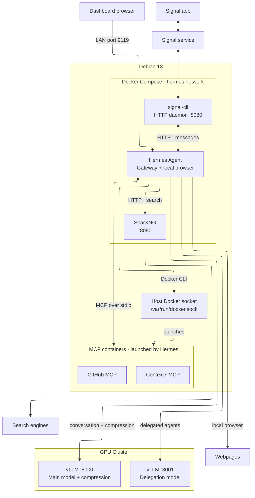

import ExpandableImage from "../../components/ExpandableImage.astro";
import ContentAside from "../../components/ContentAside.astro";
import CodeTabs from "../../components/CodeTabs.astro";
import signalScreenshot from "../../assets/images/hermes-agent-signal-light.jpg";
import signalScreenshotDark from "../../assets/images/hermes-agent-signal-dark.jpg";

<Note>

**Update (26 October):** I misread the Hermes docs, as usual with documentation. The setting is `web.backend: searxng`, not `web.search_backend: searxng`. The old key isn't invalid, but it only covers searching, so you end up without `web_extract`. Hermes did still use SearXNG, but only by improvising with `curl`, which timed out or returned weird results. I've fixed the config below and added the official `searxng-search` skill.

</Note>

Whenever documentation tells me to install something with a shell script, my first thought is _Could I just containerize this instead?_ So I tried it with Hermes Agent. Docker is officially supported, but I wanted to see whether the setup would meet my standards and satisfy my autisticness.

### Initial setup

Start with a `compose.yaml` file:

```yaml title="~/compose.yaml"
services:
  hermes:
    image: nousresearch/hermes-agent:v0.21.6
    container_name: hermes
    restart: unless-stopped
    command: gateway run

    ports:
      - "9119:9119"

    volumes:
      - ${HOME}/.hermes:/opt/data

    environment:
      HERMES_UID: "10000"
      HERMES_GID: "10000"
      HERMES_DASHBOARD: "1"
      HERMES_DASHBOARD_HOST: "0.0.0.0"
      TZ: Europe/Amsterdam

networks:
  default:
    name: hermes
```

Create the directory for Hermes's configuration and data:

```sh
mkdir -p ~/.hermes
```

Create `~/.hermes/config.yaml`:

```yaml title="~/.hermes/config.yaml"
_config_version: 50

model:
  base_url: ${VLLM_API_URL}
  default: ${VLLM_API_MODEL}
  provider: custom
  api_key: ${VLLM_API_KEY}

delegation:
  model: ${VLLM_DELEGATION_MODEL}
  provider: custom
  base_url: ${VLLM_DELEGATION_URL}
  api_key: ${VLLM_DELEGATION_KEY}
  api_mode: chat_completions
  max_iterations: 500
  reasoning_effort: medium
  max_concurrent_children: 2
  max_spawn_depth: 2
  orchestrator_enabled: true
  compression_threshold_tokens: 98304

agent:
  max_turns: 0
  system_prompt: |
    # Delegation policy

    Use delegation deliberately to improve results, parallelize
    independent work, and keep detailed investigations out of the
    main conversation.

    Before substantial tasks, evaluate whether delegation
    would provide a real advantage.

    Delegate when:
    - A task has independent research or analysis workstreams.
    - A bounded investigation requires substantial tool use.
    - Independent review would materially improve correctness.
    - A subtask can produce a clear, independently verifiable result.

    Work directly when:
    - The answer is straightforward.
    - The task requires only one or two simple tool calls.
    - Delegation would add overhead without improving the result.
    - Work is purely mechanical and better handled by execute_code.

    Delegation execution:
    - Use the delegate_task tool, not a simulated delegation.
    - Prefer one batch containing up to two independent tasks.
    - Give each child a specific, self-contained goal and context.
    - Include relevant file paths, constraints, expected output,
      and acceptance criteria in each child's context.
    - Do not assume children know the parent conversation,
      personality instructions, or previous tool results.
    - Never parallelize dependent tasks; dispatch later stages
      after their prerequisites finish.
    - Allow nested delegation only when it provides real value.
    - Keep final synthesis, decisions, and integration with
      the parent agent.

    Verification:
    - Treat child summaries as unverified reports.
    - Check material claims, generated files, tests, and changes.
    - Do not claim success solely because a child completed.
    - If a child fails, retry with a narrower task or handle
      the remaining work directly.

    Background execution:
    - After dispatching, complete other independent work.
    - If nothing independent remains, end the turn.
    - Do not poll child transcripts or repeatedly check status.
    - Continue synthesis when delegation results are delivered.

    Be concise and direct. Do not narrate delegation decisions
    unless useful to the user.

compression:
  enabled: true
  threshold_tokens: 131072
  tail_mode: lean
  in_place: true
  context_timeout_seconds: 600

auxiliary:
  compression:
    model: ${VLLM_COMPRESSION_MODEL}
    base_url: ${VLLM_COMPRESSION_URL}
    api_key: ${VLLM_COMPRESSION_KEY}
    timeout: 600
    max_concurrency: 2

telemetry:
  shared_metrics:
    enabled: false
    send: false
    offer_version: 2
```

Add the environment variables to `~/.hermes/.env`:

```dotenv
HERMES_DASHBOARD_BASIC_AUTH_USERNAME=""
HERMES_DASHBOARD_BASIC_AUTH_PASSWORD=""
HERMES_DASHBOARD_BASIC_AUTH_SECRET="<openssl rand -base64 32>"

VLLM_API_KEY=""
VLLM_API_URL="http://192.168.1.2:8000/v1"
VLLM_API_MODEL="Qwen/Qwen3.8-27B"

VLLM_DELEGATION_KEY=""
VLLM_DELEGATION_URL="http://192.168.1.2:8001/v1"
VLLM_DELEGATION_MODEL="Qwen/Qwen3.8-27B-Agents"

VLLM_COMPRESSION_KEY=""
VLLM_COMPRESSION_URL="http://192.168.1.2:8000/v1"
VLLM_COMPRESSION_MODEL="Qwen/Qwen3.8-27B"
```

Don't forget to set the correct permissions. This file holds your secrets, so not everyone on the host needs to read it:

```sh
chmod 600 ~/.hermes/.env
```

Hermes ships with a pile of bundled skills I never asked for. Create `.no-bundled-skills` to prevent it from syncing them into `~/.hermes/skills/`:

```sh
touch ~/.hermes/.no-bundled-skills
```

The Hermes container runs as user `10000`, who doesn't exist on my host and has never paid rent. Even so, the files in `~/.hermes` need to belong to that user:

```sh
sudo chown -R 10000:10000 ~/.hermes
```

Then start the container, and hope it behaves:

```sh
docker compose up -d
```

Check the logs for errors. If there are none, stop and remove the container stack. The configuration and data stay in `~/.hermes`:

```sh
docker compose down
```

### Search capabilities

For web searches I use [SearXNG](https://docs.searxng.org/), running in a separate container. Create its configuration directory:

```bash
mkdir -p ~/.searxng/config
```

Create `~/.searxng/config/settings.yml` with JSON output enabled so Hermes can read the search results:

```yaml
use_default_settings: true

server:
  secret_key: "<openssl rand -hex 32>"
  image_proxy: true

search:
  formats:
    - html
    - json
```

Add the SearXNG service to `compose.yaml`:

```yaml
searxng:
  image: searxng/searxng:2026.10.9-f4822b3fc
  container_name: searxng
  restart: unless-stopped

  ports:
    - "127.0.0.1:8888:8080"

  volumes:
    - ${HOME}/.searxng/config:/etc/searxng
    - searxng-cache:/var/cache/searxng

  healthcheck:
    test:
      [
        "CMD",
        "wget",
        "-q",
        "--spider",
        "--proxy=off",
        "http://127.0.0.1:8080/healthz",
      ]
    interval: 10s
    timeout: 5s
    retries: 5
    start_period: 15s

volumes:
  searxng-cache:
    name: searxng-cache
```

Add a dependency on SearXNG to the Hermes service so it waits for SearXNG's health check to pass. Also give the container more shared memory (`shm_size`), which the local browser needs to render pages:

```yaml
hermes:
  image: nousresearch/hermes-agent:v0.21.6
  container_name: hermes
  restart: unless-stopped
  command: gateway run

  shm_size: "4gb" # [!code ++]

  depends_on: # [!code ++]
    searxng: # [!code ++]
      condition: service_healthy # [!code ++]
```

Add the SearXNG URL to `~/.hermes/.env`. The containers share a Docker network, so Hermes can reach SearXNG by its service name:

```dotenv
SEARXNG_URL=http://searxng:8080
```

Set the search backend in `~/.hermes/config.yaml`:

```yaml
web:
  backend: searxng

browser:
  cloud_provider: local
```

Hermes also needs the [searxng-search](https://github.com/NousResearch/hermes-agent/blob/main/optional-skills/research/searxng-search/SKILL.md) skill to know how to talk to SearXNG. I disabled the bundled skills, so I install this one by hand:

```sh
docker compose run --rm hermes skills install official/research/searxng-search
```

Don't forget to add the search instructions to the system prompt in `~/.hermes/config.yaml`. Yes, including the line telling it not to fabricate sources. Apparently that needs saying:

```yaml
    Be concise and direct. Do not narrate delegation decisions
    unless useful to the user.

    # Internet research policy # [!code ++]

    Use internet research proactively when external information # [!code ++]
    would materially improve accuracy or usefulness. # [!code ++]

    Search when: # [!code ++]
    - Information may have changed since training. # [!code ++]
    - Questions concern software, APIs, documentation, releases, # [!code ++]
      security advisories, or compatibility. # [!code ++]
    - The user requests research, comparisons, or verification. # [!code ++]
    - Important facts are unfamiliar, uncertain, or disputed. # [!code ++]

    Avoid unnecessary searches for straightforward questions # [!code ++]
    or tasks involving only user-provided content. # [!code ++]

    Research workflow: # [!code ++]
    - Use web_search to discover sources through SearXNG. # [!code ++]
    - Use browser_navigate to open relevant webpages locally. # [!code ++]
    - Read the snapshot returned by browser_navigate. # [!code ++]
    - Use browser_snapshot when additional page context is needed. # [!code ++]
    - Follow relevant links when deeper verification is required. # [!code ++]
    - Prefer official documentation, primary sources, and # [!code ++]
      authoritative publications. # [!code ++]
    - Check publication dates and software versions. # [!code ++]
    - Cross-check consequential claims using independent sources. # [!code ++]
    - Distinguish verified facts from assumptions. # [!code ++]
    - Include source URLs for externally verified claims. # [!code ++]
    - Never fabricate findings, quotations, or sources. # [!code ++]
    - Do not expose secrets in search queries or URLs. # [!code ++]

    Tool selection: # [!code ++]
    - Prefer web_search for discovering information. # [!code ++]
    - Prefer browser_navigate for reading webpages. # [!code ++]
    - Use browser interactions for JavaScript-rendered content. # [!code ++]
    - Use web_extract only if a working extraction provider # [!code ++]
      is configured. # [!code ++]
    - Avoid browser automation when simpler available tools # [!code ++]
      can reliably complete the task. # [!code ++]

    Research and delegation: # [!code ++]
    - Delegate substantial, independent research workstreams. # [!code ++]
    - Require children to return findings and source URLs. # [!code ++]
    - Give children clear research questions and constraints. # [!code ++]
    - Verify important child findings before final synthesis. # [!code ++]
    - Handle small lookups directly without delegation. # [!code ++]

    If a tool fails, use an appropriate available alternative. # [!code ++]
    Never claim to have verified information that was not read. # [!code ++]
```

### Talking through Signal

Create the directory for Signal's data:

```sh
mkdir -p ~/.signal
```

The container expects the directory to belong to its `signal-cli` user. Use the image to set the ownership:

```bash
docker run --rm \
  --user 0:0 \
  -v "${HOME}/.signal:/var/lib/signal-cli" \
  --entrypoint chown \
  registry.gitlab.com/packaging/signal-cli/signal-cli-jre:v0-14-9-2 \
  -v signal-cli:signal-cli /var/lib/signal-cli
```

On my host, the directory looks like this after changing its ownership:

```sh
drwxrwxr-x  2     101 netdev  4.0K Oct  9 22:43 .signal
```

Add the Signal service to `compose.yaml`:

```yaml
signal:
  image: registry.gitlab.com/packaging/signal-cli/signal-cli-jre:v0-14-9-2
  container_name: signal
  restart: unless-stopped
  command: daemon --http 0.0.0.0:8080

  volumes:
    - ${HOME}/.signal:/var/lib/signal-cli
```

Add Signal to the Hermes service's existing `depends_on` block, alongside SearXNG:

```yaml
hermes:
  image: nousresearch/hermes-agent:v0.21.6
  container_name: hermes
  restart: unless-stopped
  command: gateway run

  shm_size: "4gb"

  depends_on:
    searxng:
      condition: service_healthy
    signal: # [!code ++]
      condition: service_started # [!code ++]
```

On the first start, the Signal container exits because it has no registered account. It sulks in the logs:

```sh
signal   | Failed to read local accounts list
signal exited with code 3 (restarting)
```

Register a phone number for Hermes to use with Signal. Replace `+31687654321` with that number in the commands below.

Stop the container with `docker compose stop signal`, then run:

```sh
docker compose run --rm signal -a +31687654321 register --captcha 'signalcaptcha://REDACTED'
```

Pretty much every time I register a number with Signal, I have to complete a CAPTCHA. I don't know if that's a bug or a feature, but it is what it is. Apparently I have to prove I'm human before I can set up a chat with a bot. You can generate a CAPTCHA URL at [signalcaptchas.org/registration/generate](https://signalcaptchas.org/registration/generate).

If registration succeeds, you will receive a verification code via SMS. Replace `123-456` with that code to verify the number:

```sh
docker compose run --rm signal -a +31687654321 verify '123-456'
```

Check the registered accounts:

```sh
docker compose run --rm signal listAccounts
```

The output should include your registered number:

```sh
Number: +31687654321
```

Fill in the profile, starting with the name:

```sh
docker run --rm --volumes-from signal \
  registry.gitlab.com/packaging/signal-cli/signal-cli-jre:v0-14-9-2 \
  updateProfile --name "Hermes Agent"
```

Set the username:

```sh
docker run --rm --volumes-from signal \
  registry.gitlab.com/packaging/signal-cli/signal-cli-jre:v0-14-9-2 \
  updateAccount --username hermesagent.1337
```

Set the profile's about text:

```sh
docker run --rm --volumes-from signal \
  registry.gitlab.com/packaging/signal-cli/signal-cli-jre:v0-14-9-2 \
  updateProfile --about "I might be a clanker"
```

Bring the Signal container back up with `docker compose start signal`.

Add these environment variables to `~/.hermes/.env`. Use the number you registered for Hermes as `SIGNAL_ACCOUNT`, and your personal number for `SIGNAL_ALLOWED_USERS` and `SIGNAL_HOME_CHANNEL`:

```dotenv
SIGNAL_HTTP_URL=http://signal:8080
SIGNAL_ACCOUNT=+31687654321
SIGNAL_ALLOWED_USERS=+31612345678
SIGNAL_HOME_CHANNEL=+31612345678
```

Enable Signal in `~/.hermes/config.yaml`:

```yaml
platforms:
  signal:
    enabled: true
```

<ContentAside>
Before sending the test message, stop the Signal container with `docker compose stop signal`. The daemon holds the account lock, so a second signal-cli process waits until the daemon stops.
<br />
Replace the recipient at the end of this command with your personal number, then send the test message:

<ExpandableImage
  slot="aside"
  id="hermes-signal"
  src={signalScreenshot}
  darkSrc={signalScreenshotDark}
  alt="Signal message request from Hermes Agent with the test message: Hi Ricardo! This is Hermes Agent."
  caption="The test message arriving in Signal."
/>
</ContentAside>

```sh
docker run --rm --volumes-from signal \
  -e LANG=C.UTF-8 -e LC_ALL=C.UTF-8 \
  registry.gitlab.com/packaging/signal-cli/signal-cli-jre:v0-14-9-2 \
  send -m "Hi Ricardo! This is Hermes Agent 🤖" +31612345678
```

Start the Signal container again with `docker compose start signal` after the message arrives. Hermes now has a phone number and a profile. I'm not sure my own social life is this well organized.

### MCP

Security and privacy officers, close your eyes for a moment. Hermes already supports MCP servers, but I'm giving it access to the Docker socket on my host so it can run them there in containers. That's effectively root on my server, handed to a language model. What could possibly go wrong? First, shut down the stack with `docker compose down -v`. Add the Docker socket to the Hermes service's volumes:

```yaml
volumes:
  - ${HOME}/.hermes:/opt/data
  - /var/run/docker.sock:/var/run/docker.sock # [!code ++]
```

Add a GitHub personal access token to `~/.hermes/.env`:

```dotenv
GITHUB_TOKEN="github_pat_xxxx"
```

Add the GitHub MCP server to `~/.hermes/config.yaml`:

```yaml
mcp_servers:
  github:
    command: "docker"
    args:
      - "run"
      - "-i"
      - "--rm"
      - "-e"
      - "GITHUB_PERSONAL_ACCESS_TOKEN"
      - "-e"
      - "GITHUB_TOOLSETS"
      - "ghcr.io/github/github-mcp-server:v2.0.2"

    env:
      GITHUB_PERSONAL_ACCESS_TOKEN: "${GITHUB_TOKEN}"
      GITHUB_TOOLSETS: "all"

    timeout: 120
    connect_timeout: 60
```

Bring the stack back up with `docker compose up -d`. Check that the GitHub MCP container is running:

```sh
[16:22:13 ricardo@zeus ~] # docker ps \
  --filter "ancestor=ghcr.io/github/github-mcp-server:v2.0.2" \
  --format "table {{.Names}}\t{{.Status}}"
NAMES            STATUS
tender_ptolemy   Up 4 minutes
```

Check the connection by asking Hermes who you are on GitHub. Handy, because some days I'm not sure myself:

```sh
❯ Can you verify who I am on GitHub?

┊  I'll check the authenticated GitHub account.

└─ ▾ Tool calls (3)
  ├─ ● 🔎 Searching tools · get authenticated github user profile (0.1s)
  ├─ ● 📖 Reading tool details · 1 tool (0.1s)
  └─ ● 🔌 GitHub · get me (0.3s)
├─ ▸ Thinking  ~22 tokens
└─ Σ ~55 total

┊  You're authenticated to GitHub as Ricardo de Vries (ricardodevries).

  • Profile: https://github.com/ricardodevries
  • User ID: 78354174
```

Add Context7 under the same `mcp_servers` block in `~/.hermes/config.yaml`:

```yaml
context7:
  command: "docker"
  args:
    - "run"
    - "-i"
    - "--rm"
    - "-e"
    - "MCP_TRANSPORT=stdio"
    - "-e"
    - "CONTEXT7_API_KEY"
    - "mcp/context7:latest"

  env:
    CONTEXT7_API_KEY: "${CONTEXT7_API_KEY}"

  timeout: 120
  connect_timeout: 60
```

Add your Context7 API key to `~/.hermes/.env`:

```dotenv
CONTEXT7_API_KEY=""
```

Run `docker compose up -d` again, then check that the Context7 container is running:

```sh
[17:24:09 ricardo@zeus ~] # docker ps \
  --filter "ancestor=mcp/context7:latest" \
  --format "table {{.Names}}\t{{.Status}}"
NAMES           STATUS
amazing_noyce   Up 2 minutes
```

Test Context7 by asking Hermes to look up Docker Compose's `depends_on` behavior:

```sh
❯ Use Context7 to look up how Docker Compose's depends_on works with service_healthy, and show a minimal YAML example.
 ┊  I'll look up Context7's tools and search for the Docker Compose library.
 └─ ▾ Tool calls (1)
   └─ ● 🔎 Searching tools · context7 get library docs (0.1s)
 └─ Response
 ┊  Let me resolve the Docker Compose library ID and fetch its docs.
 └─ ▾ Tool calls (2)
   ├─ ● 🔌 Context7 · resolve library id (0.5s)
   └─ ● 🔌 Context7 · resolve library id (0.4s)
 ┊  Found the right library: /docker/compose (trust 9.9, 1070 snippets). Let me fetch docs on depends_on with service_healthy.
 └─ ▾ Tool calls (2)
   ├─ ● 📖 Reading tool details · 1 tool (0.1s)
   └─ ● 🔌 Context7 · get library docs (0.8s)
 ┊  The docs came back heavy on the provider/extension mechanism, not the specific depends_on condition. Let me pull the
    authoritative Compose Specification for the depends_on condition syntax.
 └─ ▾ Tool calls (1)
   └─ ● 🔌 Context7 · get library docs (0.9s)
 └─ Response
 ┊  From Context7 (Docker Compose + the authoritative Compose Specification):
    [...]
```

For now, this setup fits how I run things on my server, and my autisticness is satisfied. We'll see how long that lasts. Probably not long.

### Final files

For completeness, here are the full files from this post, for everyone who scrolled straight to the bottom. I see you:

<CodeTabs>

```yaml title="~/compose.yaml"
services:
  hermes:
    image: nousresearch/hermes-agent:v0.21.6
    container_name: hermes
    restart: unless-stopped
    command: gateway run

    shm_size: "4gb"

    depends_on:
      searxng:
        condition: service_healthy
      signal:
        condition: service_started

    ports:
      - "9119:9119"

    volumes:
      - ${HOME}/.hermes:/opt/data
      - /var/run/docker.sock:/var/run/docker.sock

    environment:
      HERMES_UID: "10000"
      HERMES_GID: "10000"
      HERMES_DASHBOARD: "1"
      HERMES_DASHBOARD_HOST: "0.0.0.0"
      TZ: Europe/Amsterdam

  searxng:
    image: searxng/searxng:2026.10.9-f4822b3fc
    container_name: searxng
    restart: unless-stopped

    ports:
      - "127.0.0.1:8888:8080"

    volumes:
      - ${HOME}/.searxng/config:/etc/searxng
      - searxng-cache:/var/cache/searxng

    healthcheck:
      test: ["CMD", "wget", "-q", "--spider", "--proxy=off", "http://127.0.0.1:8080/healthz"]
      interval: 10s
      timeout: 5s
      retries: 5
      start_period: 15s

  signal:
    image: registry.gitlab.com/packaging/signal-cli/signal-cli-jre:v0-14-9-2
    container_name: signal
    restart: unless-stopped
    command: daemon --http 0.0.0.0:8080

    volumes:
      - ${HOME}/.signal:/var/lib/signal-cli

networks:
  default:
    name: hermes

volumes:
  searxng-cache:
    name: searxng-cache
```

```yaml title="~/.hermes/config.yaml"
_config_version: 50

model:
  base_url: ${VLLM_API_URL}
  default: ${VLLM_API_MODEL}
  provider: custom
  api_key: ${VLLM_API_KEY}

delegation:
  model: ${VLLM_DELEGATION_MODEL}
  provider: custom
  base_url: ${VLLM_DELEGATION_URL}
  api_key: ${VLLM_DELEGATION_KEY}
  api_mode: chat_completions
  max_iterations: 500
  reasoning_effort: medium
  max_concurrent_children: 2
  max_spawn_depth: 2
  orchestrator_enabled: true
  compression_threshold_tokens: 98304

agent:
  max_turns: 0
  system_prompt: |
    # Delegation policy

    Use delegation deliberately to improve results, parallelize
    independent work, and keep detailed investigations out of the
    main conversation.

    Before substantial tasks, evaluate whether delegation
    would provide a real advantage.

    Delegate when:
    - A task has independent research or analysis workstreams.
    - A bounded investigation requires substantial tool use.
    - Independent review would materially improve correctness.
    - A subtask can produce a clear, independently verifiable result.

    Work directly when:
    - The answer is straightforward.
    - The task requires only one or two simple tool calls.
    - Delegation would add overhead without improving the result.
    - Work is purely mechanical and better handled by execute_code.

    Delegation execution:
    - Use the delegate_task tool, not a simulated delegation.
    - Prefer one batch containing up to two independent tasks.
    - Give each child a specific, self-contained goal and context.
    - Include relevant file paths, constraints, expected output,
      and acceptance criteria in each child's context.
    - Do not assume children know the parent conversation,
      personality instructions, or previous tool results.
    - Never parallelize dependent tasks; dispatch later stages
      after their prerequisites finish.
    - Allow nested delegation only when it provides real value.
    - Keep final synthesis, decisions, and integration with
      the parent agent.

    Verification:
    - Treat child summaries as unverified reports.
    - Check material claims, generated files, tests, and changes.
    - Do not claim success solely because a child completed.
    - If a child fails, retry with a narrower task or handle
      the remaining work directly.

    Background execution:
    - After dispatching, complete other independent work.
    - If nothing independent remains, end the turn.
    - Do not poll child transcripts or repeatedly check status.
    - Continue synthesis when delegation results are delivered.

    Be concise and direct. Do not narrate delegation decisions
    unless useful to the user.

    # Internet research policy

    Use internet research proactively when external information
    would materially improve accuracy or usefulness.

    Search when:
    - Information may have changed since training.
    - Questions concern software, APIs, documentation, releases,
      security advisories, or compatibility.
    - The user requests research, comparisons, or verification.
    - Important facts are unfamiliar, uncertain, or disputed.

    Avoid unnecessary searches for straightforward questions
    or tasks involving only user-provided content.

    Research workflow:
    - Use web_search to discover sources through SearXNG.
    - Use browser_navigate to open relevant webpages locally.
    - Read the snapshot returned by browser_navigate.
    - Use browser_snapshot when additional page context is needed.
    - Follow relevant links when deeper verification is required.
    - Prefer official documentation, primary sources, and
      authoritative publications.
    - Check publication dates and software versions.
    - Cross-check consequential claims using independent sources.
    - Distinguish verified facts from assumptions.
    - Include source URLs for externally verified claims.
    - Never fabricate findings, quotations, or sources.
    - Do not expose secrets in search queries or URLs.

    Tool selection:
    - Prefer web_search for discovering information.
    - Prefer browser_navigate for reading webpages.
    - Use browser interactions for JavaScript-rendered content.
    - Use web_extract only if a working extraction provider
      is configured.
    - Avoid browser automation when simpler available tools
      can reliably complete the task.

    Research and delegation:
    - Delegate substantial, independent research workstreams.
    - Require children to return findings and source URLs.
    - Give children clear research questions and constraints.
    - Verify important child findings before final synthesis.
    - Handle small lookups directly without delegation.

    If a tool fails, use an appropriate available alternative.
    Never claim to have verified information that was not read.

compression:
  enabled: true
  threshold_tokens: 131072
  tail_mode: lean
  in_place: true
  context_timeout_seconds: 600

auxiliary:
  compression:
    model: ${VLLM_COMPRESSION_MODEL}
    base_url: ${VLLM_COMPRESSION_URL}
    api_key: ${VLLM_COMPRESSION_KEY}
    timeout: 600
    max_concurrency: 2

telemetry:
  shared_metrics:
    enabled: false
    send: false
    offer_version: 2

web:
  backend: searxng

browser:
  cloud_provider: local

platforms:
  signal:
    enabled: true

mcp_servers:
  github:
    command: "docker"
    args:
      - "run"
      - "-i"
      - "--rm"
      - "-e"
      - "GITHUB_PERSONAL_ACCESS_TOKEN"
      - "-e"
      - "GITHUB_TOOLSETS"
      - "ghcr.io/github/github-mcp-server:v2.0.2"

    env:
      GITHUB_PERSONAL_ACCESS_TOKEN: "${GITHUB_TOKEN}"
      GITHUB_TOOLSETS: "all"

    timeout: 120
    connect_timeout: 60

  context7:
    command: "docker"
    args:
      - "run"
      - "-i"
      - "--rm"
      - "-e"
      - "MCP_TRANSPORT=stdio"
      - "-e"
      - "CONTEXT7_API_KEY"
      - "mcp/context7:latest"

    env:
      CONTEXT7_API_KEY: "${CONTEXT7_API_KEY}"

    timeout: 120
    connect_timeout: 60
```

```dotenv title="~/.hermes/.env"
HERMES_DASHBOARD_BASIC_AUTH_USERNAME=""
HERMES_DASHBOARD_BASIC_AUTH_PASSWORD=""
HERMES_DASHBOARD_BASIC_AUTH_SECRET="<openssl rand -base64 32>"

VLLM_API_KEY=""
VLLM_API_URL="http://192.168.1.2:8000/v1"
VLLM_API_MODEL="Qwen/Qwen3.8-27B"

VLLM_DELEGATION_KEY=""
VLLM_DELEGATION_URL="http://192.168.1.2:8001/v1"
VLLM_DELEGATION_MODEL="Qwen/Qwen3.8-27B-Agents"

VLLM_COMPRESSION_KEY=""
VLLM_COMPRESSION_URL="http://192.168.1.2:8000/v1"
VLLM_COMPRESSION_MODEL="Qwen/Qwen3.8-27B"

GITHUB_TOKEN="github_pat_xxxx"
CONTEXT7_API_KEY="ctx7sk-xxxx"

SEARXNG_URL=http://searxng:8080

SIGNAL_HTTP_URL=http://signal:8080
SIGNAL_ACCOUNT=+31687654321
SIGNAL_ALLOWED_USERS=+31612345678
SIGNAL_HOME_CHANNEL=+31612345678
```

</CodeTabs>

### How it fits together

After all that YAML, here's whats actually built. Quite a few moving parts just to have a conversation with a clanker:



This setup might help you get started or give you an idea of how to set up Hermes Agent in a containerized and _opinionated_ way.
